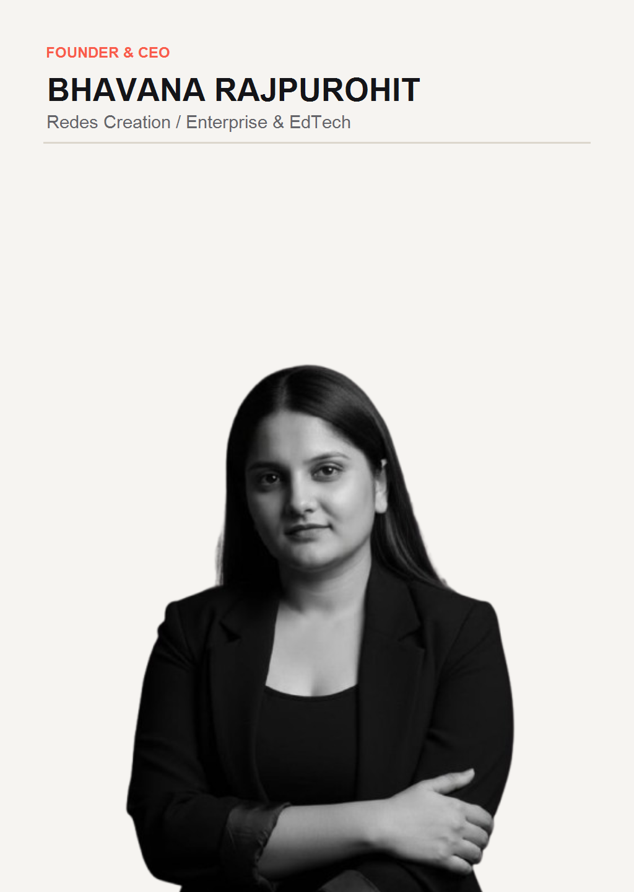
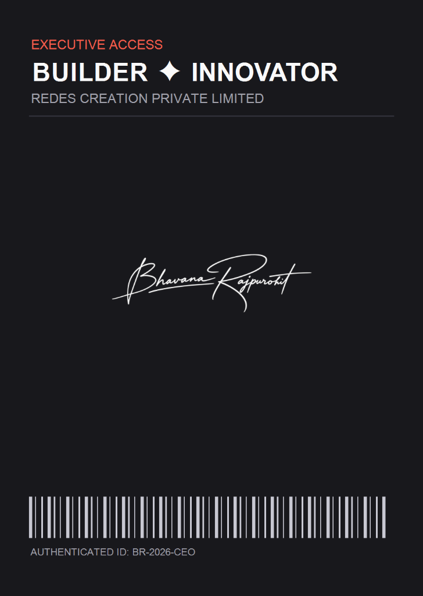

<!DOCTYPE html>
<html lang="en">

<head>
  <meta charset="utf-8">
  <meta name="color-scheme" content="dark">
  <meta name="viewport" content="width=device-width, initial-scale=1">
  <title>Bhavana Rajpurohit — Founder. Builder. Problem Solver.</title>
  <meta name="description"
    content="Bhavana Rajpurohit, founder of Redes Creation Private Limited. Technology, SaaS, ERP, higher education systems and business automation.">
  <meta property="og:title" content="Bhavana Rajpurohit — Founder Portfolio">
  <meta property="og:description" content="I build businesses. I build technology. I solve problems.">
  <meta property="og:type" content="website">
  <link rel="icon"
    href="data:image/svg+xml,%3Csvg xmlns='http://www.w3.org/2000/svg' viewBox='0 0 32 32'%3E%3Crect width='32' height='32' rx='8' fill='%230B0B0B'/%3E%3Cpath d='M18 4 8 18h7l-2 10 11-15h-7z' fill='%232563FF'/%3E%3C/svg%3E">
  <link rel="preconnect" href="https://fonts.googleapis.com">
  <link rel="preconnect" href="https://fonts.gstatic.com" crossorigin>
  <link href="https://fonts.googleapis.com/css2?family=Cabin:ital,wght@0,400..700;1,400..700&family=Source+Code+Pro:ital,wght@0,200..900;1,200..900&display=swap" rel="stylesheet">
  
</head>

<body>
  

  

  <nav class="top" aria-label="Primary">
    <a class="logo" href="#home">BHAVANA<b>.</b>RAJPUROHIT</a>
    
<a href="#home">Home</a><a href="#about">About</a><a href="#expertise">Expertise</a><a
        href="#experience">Experience</a><a href="#projects">Projects</a><a href="#contact">Contact</a>

    <button class="bg" id="bg" aria-label="Open menu" aria-expanded="false"><i></i><i></i></button>
  </nav>
  
<a href="#home">Home</a><a href="#about">About</a><a href="#expertise">Expertise</a><a
      href="#experience">Experience</a><a href="#projects">Projects</a><a href="#contact">Contact</a>

  <main>
    <header class="hero" id="home">
      <canvas id="cv" aria-hidden="true"></canvas>

      <!-- Giant typography watermark behind image -->
      

        BHAVANA
        RAJPUROHIT
      

      <!-- Cutout image centered in hero -->
      

        
      

      <!-- Two-sided content overlay -->
      

        

          

            I build businesses, technology &amp; smart systems.
          

          

            Founder. Idea collector. Problem solver. Turning complex institutional workflows and business challenges into seamless digital solutions.
          

        

        

          

            <a class="hero-action-btn" href="#contact">
              Let's talk →
            </a>
          

        

      

      <!-- Bottom feature pills -->
      

        <i></i>SaaS Platforms
        <i></i>ERP &amp; Automation
        <i></i>Higher Ed Tech
        <i></i>Compliance Systems
        <i></i>Digital Transformation
      

      
Scroll

    </header>
    

      
CEO ✦ Builder ✦ Problem Solver ✦ CEO ✦ Builder ✦ Problem Solver ✦ CEO ✦ Builder ✦ Problem Solver
        ✦ CEO ✦ Builder ✦ Problem Solver ✦ 

    

    <section class="sec" id="about">
      

        

        
The CEO
          <h2 class="rv">So… what do I actually do?</h2>
          
I'm a founder who sees a broken process and can't leave it alone.

          
I build <b>businesses</b> and <b>technology</b>, and I like the space where the two meet.

          
My approach to technology is simple: it should solve a real problem, not just look impressive.
          

          
I'm interested in business, systems, automation and anything that could work better than it does
            today.

        

      

    </section>

    <section class="sec brain panel" id="brain">
      
The founder's brain
        <h2>My brain is basically a startup.</h2>
        <h3>Warning: too many ideas. Not enough hours.</h3>
        
Creative thinkingExploring ideasProblem
            solvingExperimentationInnovation

      

      
What if we build this?

      
Why does this process suck?

      
Let's launch something.

      
Wait. I have another idea.

    </section>

    <section class="sec" id="expertise">
      Core expertise
      <h2>What I know. What I build. What I work on.</h2>
      

        

          
<small>A</small>IT &amp; Technology

          <ul>
            <li>IT &amp; Technology Strategy</li>
            <li>IT Consulting &amp; Technology Management</li>
            <li>Software &amp; Web Application Development</li>
            <li>ERP &amp; CRM Solutions</li>
            <li>SaaS Product Development</li>
            <li>Digital Transformation</li>
            <li>AI &amp; Business Automation</li>
            <li>Software Product Strategy</li>
            <li>Business Process Automation</li>
          </ul>
        

        

          
<small>B</small>Business &amp; Growth

          <ul>
            <li>Business Development &amp; Strategy</li>
            <li>Digital Marketing &amp; SEO</li>
            <li>Lead Generation</li>
            <li>Client Relationship Management</li>
            <li>Business Growth Strategy</li>
            <li>Project &amp; Team Management</li>
            <li>Product Management</li>
            <li>Technology Consulting</li>
          </ul>
        

        

          
<small>C</small>Higher Education Tech

          <ul>
            <li>Higher Education Technology Solutions</li>
            <li>University ERP &amp; Automation</li>
            <li>Digital Academic Infrastructure</li>
            <li>Institutional Process Automation</li>
            <li>University Website &amp; Digital Platforms</li>
            <li>Academic Technology Systems</li>
          </ul>
        

        

          
<small>D</small>Accreditation &amp; Compliance

          <ul>
            <li>NAAC Accreditation Support</li>
            <li>UGC Regulations &amp; Compliance</li>
            <li>DigiLocker &amp; NAD Integration</li>
            <li>NBA Accreditation Support</li>
            <li>PCI Compliance</li>
            <li>BCI Compliance</li>
            <li>Academic Data Management</li>
            <li>Institutional Digital Compliance Support</li>
          </ul>
        

      

    </section>

    <section class="sec panel" id="experience">
      

        
Professional experience
          
Founder

          <h3 class="rv" style="font-size:clamp(20px,2.4vw,34px);margin-top:20px">Redes Creation Private Limited</h3>
          
Technology · IT Consulting · Digital Solutions · Software · SaaS

          
Founder journey, business strategy, technology
            management, product development, client solutions, team management and business growth.

        

        <ul class="cols">
          <li>IT Consulting</li>
          <li>University Technology Solutions</li>
          <li>ERP Implementation</li>
          <li>Business Process Automation</li>
          <li>Website &amp; Software Development</li>
          <li>Digital Marketing</li>
          <li>Lead Generation</li>
          <li>SaaS Product Development</li>
          <li>Regulatory Compliance Support</li>
          <li>DigiLocker &amp; NAD Integration</li>
          <li>Project Leadership</li>
        </ul>
      

    </section>

    <section class="sec" id="redes">
      
<i>R</i>Redes Creation (add logo +
          website link)

      <h2 class="rv">I build things through Redes Creation.</h2>
      
Redes Creation is a technology and digital
        solutions company focused on helping businesses, institutions, and brands move forward in a digital world.

      
<a href="#">Website Design &amp; Development</a><a href="#">Software &amp; Application
          Development</a><a href="#">ERP &amp; CRM Systems</a><a href="#">SaaS Product Development</a><a
          href="#">Digital Marketing</a><a href="#">SEO</a><a href="#">Business Automation</a><a href="#">AI
          Solutions</a><a href="#">University Technology Solutions</a><a href="#">Digital Transformation</a>

    </section>

    <section class="sec panel" id="compliance">
      Higher education &amp; compliance technology
      <h2>Universities don't just need websites. They need systems.</h2>
      

        
<small>01</small>
          <h3>NAAC</h3>
          
Accreditation Support &amp; Institutional Digital Systems

        

        
<small>02</small>
          <h3>UGC</h3>
          
Regulations, Requirements &amp; Institutional Technology

        

        
<small>03</small>
          <h3>NBA</h3>
          
Accreditation Support &amp; Outcome-Oriented Systems

        

        
<small>04</small>
          <h3>DigiLocker / NAD</h3>
          
Academic Credential Digitization &amp; Integration

        

        
<small>05</small>
          <h3>PCI</h3>
          
Pharmacy Education Regulatory Requirements

        

        
<small>06</small>
          <h3>BCI</h3>
          
Legal Education Standards &amp; Institutional Systems

        

        
<small>07</small>
          <h3>University ERP</h3>
          
Academic &amp; Administrative Automation

        

        
<small>08</small>
          <h3>Higher Ed IT</h3>
          
Institutional Digital Infrastructure

        

      

    </section>

    <section class="sec" id="projects" style="padding-inline:0">
      
What I build
        <h2>Ideas are good. Building them is better.</h2>
      

      

        <article class="pc">01
          

            <h3>Enterprise Systems</h3>
            
ERP, CRM, management dashboards, automation and workflow systems.

          

        </article>
        <article class="pc">02
          

            <h3>SaaS Products</h3>
            
Subscription-based products, platforms and software ecosystems.

          

        </article>
        <article class="pc">03
          

            <h3>Education Technology</h3>
            
University portals, academic systems, digital credentials and campus platforms.

          

        </article>
        <article class="pc">04
          

            <h3>Business Automation</h3>
            
AI-powered workflows, integrations, operational tools and smart systems.

          

        </article>
        <article class="pc">05
          

            <h3>Future Products</h3>
            
New concepts, experiments, prototypes and ideas.

          

        </article>
      

    </section>

    <section aria-label="How I work">
      
How I work
        <h2>I don't have a 5-year plan carved in stone.</h2>
        
I have direction. I have ambitions. I have
          things I want to build.

      

      

        
01

        
Think big. Start messy.

      

      

        
02

        
Make mistakes. Learn fast.

      

      

        
03

        
Don't wait for permission.

      

      

        
04

        
Build before you overthink.

      

      

        
05

        
Stay hungry. Stay curious.

      

      

        
06

        
Never confuse looking busy with making progress.

      

      

        
07

        
Stay adaptable.

      

    </section>

    <section class="sec lime" id="mind">
      Unpopular opinions. Maybe not.
      <h2 style="margin-bottom:60px">Things I believe in.</h2>
      
01
        
Ideas are cheap. Execution is everything.

      

      
02
        
You don't need to be ready. You need to start.

      

      
03
        
Failure is only expensive when you learn nothing.

      

      
04
        
Being busy isn't the same as building something.

      

      
05
        
The best opportunities rarely look obvious at first.

      

    </section>

    <section class="sec" id="human">
      The human side
      <h2>Plot twist: I'm a human, not a business pitch.</h2>
      
Conversations, new experiences, random discoveries and
        behind-the-scenes moments.

      

<button type="button" id="idb" aria-pressed="false" aria-label="Flip ID card"></button>

The card behind the founder. Tap it to see the other side.

        

        
Real photo 2

        
Real photo 3

        
Real photo 4

      

    </section>

    <section class="sec fut panel" id="future">
      Future vision
      <h2>The future isn't something I want to watch.It's something I want to build.</h2>
      
Artificial IntelligenceBusiness AutomationSoftware
          DevelopmentDigital EcosystemsFuture TechnologyInnovative
          ProductsScalable Business Systems

    </section>

    <section class="sec nx" id="next">
      <h2>I'm not done.Not even close.</h2>
      

        <ul id="wd">
          <li>Ideas I haven't explored</li>
          <li>Products I haven't built</li>
          <li>Businesses I haven't started</li>
          <li>Problems I haven't solved</li>
          <li>People I haven't met</li>
          <li>Versions of myself I haven't become yet</li>
          <li>Ideas I haven't explored</li>
        </ul>
      

    </section>

    <section class="sec ct" id="contact">
      Let's connect
      <h2>Let's make somethinginteresting.</h2>
      
Have an idea? A challenge? Something crazy to build? I'm
        listening.

      
<a class="btn l mg" href="mailto:YOUR_EMAIL">Let's talk</a><a class="btn g mg" href="#">Connect
          on LinkedIn</a><a class="btn g mg" href="mailto:YOUR_EMAIL">Email me</a><a class="btn g mg" href="#">Explore
          Redes Creation</a>

      

        
<small>Email</small><a href="mailto:YOUR_EMAIL">YOUR_EMAIL</a>

        
<small>LinkedIn</small><a href="#">Add profile URL</a>

        
<small>Instagram</small><a href="#">Add profile URL</a>

        
<small>Redes Creation</small><a href="#">Add website URL</a>

      

    </section>
  </main>

  <footer class="ft" id="site-footer" aria-label="Site footer">
    
<h2 class="ft-cta ft-a">Too many ideas. One life.Let's build.</h2>
      <a class="ft-btn ft-a" style="--d:.15s" href="#contact">Let's talk ↗</a>

    

      

Bhavana Rajpurohit

        
Founder. Idea collector. Problem solver. Building businesses and technology at Redes Creation Private Limited.

      <nav class="ft-a" style="--d:.2s" aria-label="Footer"><h3>Explore</h3><a href="#home">Home</a><a href="#about">About</a><a href="#expertise">Expertise</a><a href="#experience">Experience</a><a href="#projects">Projects</a><a href="#contact">Contact</a></nav>
      
<h3>Connect</h3><a href="mailto:YOUR_EMAIL">Email me</a><a href="#">LinkedIn</a><a href="#">Instagram</a><a href="#">Redes Creation</a>

    

    
Bhavana

    
© 2026 Bhavana Rajpurohit. All rights reserved.
      <button class="ft-up" id="ftup" type="button" aria-label="Back to top">↑</button>

  </footer>

  
  
  
  
  

</body>

</html>